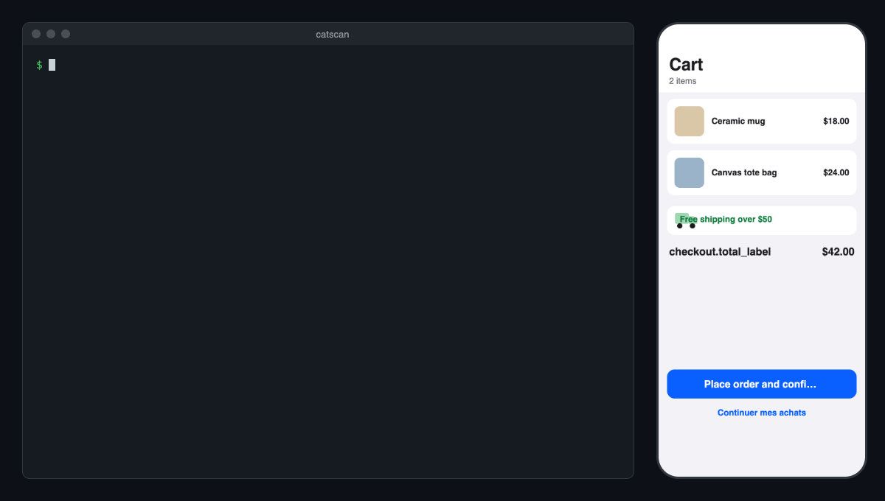
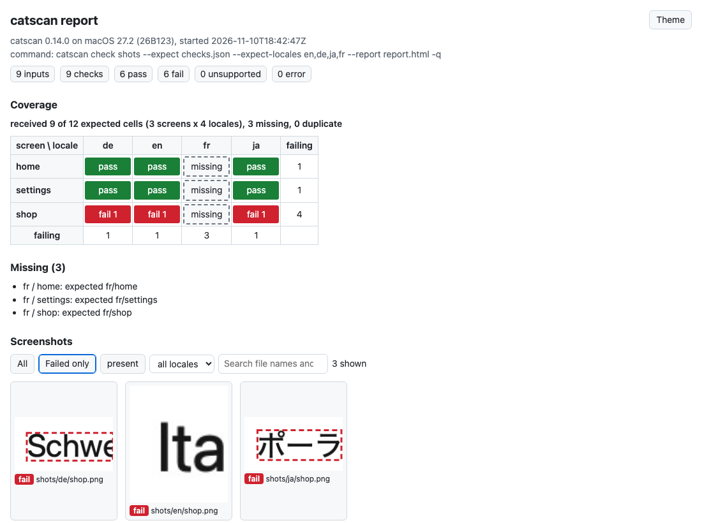

# catscan

catscan checks the text on your app and game screenshots, on your Mac, and tells you what is wrong in a verdict, not a wall of OCR. It finds the localization and UI text bugs testers otherwise find by eye, in 61 locales (about 55 languages; [full list](#benchmarks)).



## How it works

Your tests already take screenshots. catscan reads them with Apple's Vision framework on the Neural Engine, in about 25 ms an image, and checks what it read against what should be there: the strings in your catalogs, the locale of the run, the element boxes your test dumped, the phone the screen was taken on. Each check returns `PASS` or `FAIL`, an exit code for CI and `--json` for agents. Screenshots never leave the machine.

catscan says in every result which reader read the screen: Vision first, [Tesseract](docs/recipes/tesseract.md) for the languages Vision cannot read, and [the agent's own model](#when-catscan-cannot-decide) when catscan cannot decide.

## What it catches

| The problem | The check |
| --- | --- |
| A string is missing, or a string that must never show is on screen | [`catscan check --present / --absent`](docs/cli.md), keys from your catalogs (JSON, `.strings`, `.xcstrings`, `strings.xml`, TypeScript or JavaScript) with `@key` ([catalogs](docs/cli.md#catalogs)) |
| Untranslated strings, raw keys, unfilled `{placeholders}`, a line in the wrong language | [`catscan untranslated`](docs/cli.md#untranslated) |
| Text cut off with an ellipsis, by its view or by the screen edge, short of its catalog string, or drawn past its element | [`catscan truncated`](docs/cli.md#truncated) |
| Text over text, text over an icon or control, sheets drawn over each other | [`catscan overlap`](docs/cli.md#overlap) |
| Wrong number, date and price formats, a price in a currency the store does not charge | [`catscan formats`](docs/cli.md#formats) |
| Experimental: text under the camera cutout, rounded corners or home indicator, or a one-line label that wraps | [`catscan fit`](docs/cli.md#fit) with the phone's [`--device-profile`](docs/recipes/device-profile.md) (`fit --list-devices`) |
| Low contrast, text over a busy image (experimental) | [`catscan contrast`](docs/cli.md#contrast) |
| Hardcoded strings and labels too short for translation, before anything is translated | [`catscan pseudo`](docs/recipes/pseudo.md) and `--pseudo` |
| Screens that break at large system text | [`--text-size`](docs/recipes/large-text.md) |
| A locale, screen or device missing from the run | [`--expect-locales`, `--expect-screens`, `--expect-devices`](docs/results.md#coverage) and the [HTML report](docs/report.md) |
| Text that flashes by in a recording | [`catscan video`](docs/cli.md#video) |
| Re-reviewing every screen of every build | [`--baseline`](docs/results.md#changed-only-review): review only what changed |
| Old findings failing every run | [`--known`](docs/results.md#known-findings): fail only on new ones |
| Minor or uncertain findings failing the build | [`--min-severity`, `--min-certainty`](docs/cli.md#severity-and-certainty): every finding carries a severity and a certainty; gate only on what you choose |
| Failures that should show in the pull request or the CI test tab | [`--format github`, `--junit`, `--gitlab-codequality`](docs/cli.md#ci-reports) |
| Element boxes from your UI tests, results from sharded runs, one page to review a run | [`catscan boxes`](docs/truncation-capture.md), [`catscan results merge`](docs/results.md), [`catscan report`](docs/report.md); the languages this Mac reads: [`catscan languages`](docs/cli.md#languages); every command: [CLI reference](docs/cli.md) |

## Agent skills

The `catscan` plugin gives coding agents four skills. Install: Claude Code `claude plugin marketplace add gatalifeltd/catscan`, then `claude plugin install catscan@catscan`; Codex `codex plugin marketplace add gatalifeltd/catscan`, then `codex plugin add catscan@catscan`. Cursor and other agents: [`docs/start-here.md`](docs/start-here.md#skills).

| Skill | What it does for you | Try it |
| --- | --- | --- |
| `screen-check` | The agent asks catscan about a screenshot or recording instead of opening the image. [Recipe](docs/recipes/mcp.md#instruction-files) | `Does screenshots/login.png show "Sign in"? Ask catscan, do not open the image.` |
| `catscan-adopt` | Finds where your tests should check screen text, proposes the diffs, applies the batches you approve and proves each check with a mutation. [Recipe](docs/recipes/catscan-adopt.md) | `Wire catscan checks into this project's tests. Start with a dry run.` |
| `test-speedup` | Makes the suite and its CI faster without weakening what it proves. Needs no Mac: macOS or Linux, and ChatGPT in report-only mode. [Recipe](docs/recipes/test-speedup.md) | `Speed up this test suite without weakening what it proves.` |
| `catscan-upgrade` | Moves every place your project holds catscan to one version and shows the behavior changes and finding changes before you keep it. [Recipe](docs/recipes/upgrade.md) | `Run the catscan-upgrade skill.` |

## Installation

Apple silicon Mac, macOS 15 or later, Node 22 or later.

```bash
npm install --save-dev @catscan/cli
npx catscan doctor
```

## First run

Take a screenshot with Cmd+Shift+4, then:

```bash
npx catscan read ~/Desktop/Screenshot*.png
npx catscan check ~/Desktop/Screenshot*.png --present "<a word you saw>"
```

`PASS` and exit 0 mean catscan read it. Then point it at a folder of per-locale screenshots:

```bash
npx catscan untranslated shots/de --locale de --base locales/en.json --catalog locales/de.json
npx catscan truncated shots/de --locale de --boxes shots/de --report catscan-report.html
```

The report is one offline page: a locale x screen matrix where a missing screenshot shows as `missing`, and the failing screenshots with their boxes drawn ([`docs/report.md`](docs/report.md)). Next: the recipe for your stack in [`docs/start-here.md`](docs/start-here.md).



## Entry points

The CLI is the one place checks run. The other three are adapters: each calls the same checks and returns the same verdicts, shaped for where you already work.

| Entry point | Use it when |
| --- | --- |
| **CLI** `@catscan/cli` | you run checks on screenshot folders, in CI or by hand ([`docs/cli.md`](docs/cli.md), [CI recipes](docs/recipes/ci.md), [Maestro](docs/recipes/maestro.md)) |
| **Playwright matchers** `@catscan/playwright` | your web tests should assert screen text inline: `toShowText`, `toHaveNoTruncation`, `toHaveNoOverlap`, `toHaveNoUntranslated`, canvas and WebGL text included ([recipe](docs/recipes/playwright.md)) |
| **MCP server** `@catscan/mcp` | a coding agent should get a verdict of a few dozen tokens instead of opening the screenshot ([recipe](docs/recipes/mcp.md)) |
| **Agent skills**, the `catscan` plugin | an agent should do the work around the checks: [Agent skills](#agent-skills) |

## When catscan cannot decide

catscan uses readers as a ladder and says in every result which one read the screen:

1. **Vision on the Neural Engine.** The default: local, fast, free.
2. **Tesseract** for the 22 languages Vision cannot read or drops letters in (Greek, Hebrew, Croatian and more), when you install it. Weaker and slower; without it these checks are `needs-reader` (exit 3) with the install command. [`docs/recipes/tesseract.md`](docs/recipes/tesseract.md).
3. **The agent's own model.** On `needs-reader`, `unsupported`, an error, or a failed check with no useful `closest` line, the instruction files tell the agent to open the image itself.

## Benchmarks

catscan has measured 61 locales, about 55 languages when script and regional variants count once (no/nb/nn, sr/sr-Latn, zh-Hans/zh-Hant, yue-Hans/yue-Hant, ar/ars): 38 read by Vision and 23 by the Tesseract fallback. Every per-locale accuracy number is measured on synthetic images drawn by Core Text, not on device screenshots; real-screenshot numbers are the study rows. Seven locales measure under the 98% gate and are listed under the table with their numbers. A Vision locale at 96% or more stays on Vision (cs at 96.67% does, as a partial locale); only a locale below 96% would move to Tesseract, and the public gate stays 98%. Every check's own numbers: [`docs/BENCHMARKS.md`](docs/BENCHMARKS.md).

<!-- bench:start -->
Generated by `npm run bench:table`; do not edit by hand. **reproducible** rows come from the public synthetic benchmark in `bench/results/27.2/` and `bench/results/27.2.1/` (the later folder's record per locale), which anyone can rerun on an Apple-silicon Mac; per-language numbers are in [`docs/BENCHMARKS.md`](docs/BENCHMARKS.md#languages). **study** rows are quoted from the dated feasibility study over private screenshots, which cannot be published or rerun.

| Metric | Engine | Value | Source | Measured on |
| --- | --- | --- | --- | --- |
| Check accuracy, median / lowest | Vision (38 locales) | 99.58% / 96.67% (cs) | reproducible | Apple M5, macOS 27.2 (26B123), 2026-11-09; Apple M5, macOS 27.2.1 (26B131), 2026-11-11 |
| Fit recall, lowest | Vision (38 locales) | 0.867 (cs) | reproducible | Apple M5, macOS 27.2 (26B123), 2026-11-09; Apple M5, macOS 27.2.1 (26B131), 2026-11-11 |
| CER, median | Vision (38 locales) | 0.002 | reproducible | Apple M5, macOS 27.2 (26B123), 2026-11-09; Apple M5, macOS 27.2.1 (26B131), 2026-11-11 |
| Truncation precision / recall, pooled | Vision (38 locales) | 0.989 / 0.871 | reproducible | Apple M5, macOS 27.2 (26B123), 2026-11-09; Apple M5, macOS 27.2.1 (26B131), 2026-11-11 |
| Median ms per image | Vision (38 locales) | 25 (under load) | reproducible | Apple M5, macOS 27.2 (26B123), 2026-11-09; Apple M5, macOS 27.2.1 (26B131), 2026-11-11 |
| Check accuracy, median / lowest | Tesseract fallback (23 locales) | 99.27% / 84.31% (fa) | reproducible | Apple M5, macOS 27.2 (26B123), 2026-11-09; Apple M5, macOS 27.2.1 (26B131), 2026-11-11 |
| Fit recall, lowest | Tesseract fallback (23 locales) | 0.372 (fa) | reproducible | Apple M5, macOS 27.2 (26B123), 2026-11-09; Apple M5, macOS 27.2.1 (26B131), 2026-11-11 |
| CER, median | Tesseract fallback (23 locales) | 0.005 | reproducible | Apple M5, macOS 27.2 (26B123), 2026-11-09; Apple M5, macOS 27.2.1 (26B131), 2026-11-11 |
| Truncation precision / recall, pooled | Tesseract fallback (23 locales) | 1.000 / 0.810 | reproducible | Apple M5, macOS 27.2 (26B123), 2026-11-09; Apple M5, macOS 27.2.1 (26B131), 2026-11-11 |
| Median ms per image | Tesseract fallback (23 locales) | 105 (under load) | reproducible | Apple M5, macOS 27.2 (26B123), 2026-11-09; Apple M5, macOS 27.2.1 (26B131), 2026-11-11 |
| Overlap with element boxes (`--boxes`), precision / recall, overlaps of 4 px and more: text over text; text over an icon or image | Vision (12 languages) | 0.908 / 0.622; 0.913 / 0.778 | [reproducible](docs/BENCHMARKS.md#overlap-from-element-boxes) | Apple M5, macOS 27.2.1 (26B131), 2026-11-16 |
| Overlap without boxes (OCR only), precision / recall, overlaps of 4 px and more (experimental: under the gate) | Vision (12 languages) | 1.000 / 0.025 | [reproducible](docs/BENCHMARKS.md#overlap-without-boxes) | Apple M5, macOS 27.2.1 (26B131), 2026-11-11 |
| Line recall on real screenshots, pooled | Vision / Tesseract (474 screenshots, 8 locales) | 98.50 / 74.23% | [study](docs/BENCHMARKS.md#real-screenshots) | Apple M5, macOS 27.2 (26B123), feasibility study, 2026-10-29 |
| Check accuracy on real screenshots | Vision, Tesseract for Greek (189 checks) | 99.47% | [study](docs/BENCHMARKS.md#real-screenshots) | Apple M5, macOS 27.2 (26B123), feasibility study, 2026-10-30 |
| Median ms per full-resolution phone screenshot, idle | Vision / Tesseract | 58 / 230 ms | [study](docs/BENCHMARKS.md#real-screenshots) | Apple M5, macOS 27.2 (26B123), feasibility study, 2026-10-29 |
| Energy per screenshot above idle | Vision / Tesseract | about 0.3 / 1.1 J | [study](docs/BENCHMARKS.md#energy) | Apple M5, macOS 27.2 (26B123), feasibility study, 2026-10-30 |
| Check accuracy, LLM APIs | 6 Claude and GPT models | 98.41-100% | [study](docs/BENCHMARKS.md#llm-apis) | Apple M5, macOS 27.2 (26B123), feasibility study, 2026-10-30 |
| Median ms per check, LLM APIs | 6 Claude and GPT models | 1300-3220 ms | [study](docs/BENCHMARKS.md#llm-apis) | Apple M5, macOS 27.2 (26B123), feasibility study, 2026-10-30 |
| USD per 1000 checks, LLM APIs (list prices of 2026-10-30) | 6 Claude and GPT models | 0.19-8.45 | [study](docs/BENCHMARKS.md#llm-apis) | Apple M5, macOS 27.2 (26B123), feasibility study, 2026-10-30 |
| Median ms per check, coding agents | Codex, Cursor (3 models) | 8620-15490 ms | [study](docs/BENCHMARKS.md#coding-agents) | Apple M5, macOS 27.2 (26B123), feasibility study, 2026-10-30 |
| Agent tokens, one check verdict vs the screenshot | catscan | 36x fewer | [study](docs/BENCHMARKS.md#agent-tokens) | Apple M5, macOS 27.2 (26B123), feasibility study, 2026-10-29 |
| e2e suite slowdown with OCR running beside it | Vision | under 1% | [study](docs/BENCHMARKS.md#beside-an-e2e-suite) | Apple M5, macOS 27.2 (26B123), feasibility study, 2026-10-29 |

**Coverage** (generated): 61 locales recorded, every number measured on synthetic images drawn by Core Text, not on device screenshots. Vision (38): ar, ars, ca, cs, da, de, en, es, eu, fi, fil, fr, gl, hi, id, it, ja, ko, lb, mr, ms, nb, nl, nn, no, pl, pt-BR, ro, ru, sv, th, tr, uk, vi, yue-Hans, yue-Hant, zh-Hans, zh-Hant. Tesseract fallback (23): be, bg, bs, cy, el, et, fa, ga, he, hr, hu, hy, is, ka, lt, lv, mk, mt, sk, sl, sq, sr, sr-Latn.

**Under the 98% gate:** fa 84.31% (Tesseract, partial), hy 96.56% (Tesseract, partial), cs 96.67% (Vision, partial), sq 97.15% (Tesseract, partial), mt 97.50% (Tesseract, partial), ars 97.67% (Vision, partial), mr 97.85% (Vision, partial). Every other locale measures at or above 98% check accuracy.

**Recorded twice, the later record counts:** ar, da, nl, no, nb, sv, fi (`27.2.1` over `27.2`).

- Rerun (full, about 1.5 h on an M5): `npm run bench -- --record`, then `npm run bench:table`. Timing depends on the chip and load; the summary prints your numbers next to the reference run.
- Rerun (quick, a few minutes, compared with the recorded quick run): `npm run bench -- --quick`.
- Check that this table matches the committed results (Node only): `npm run bench:check`.
<!-- bench:end -->

## Updating

Move every `@catscan/` package, CI pin, MCP config and skill together: `catscan-upgrade` does it and shows which findings change ([`docs/recipes/upgrade.md`](docs/recipes/upgrade.md)). `catscan doctor` tells you when a newer version is out.

## Commercial services

Need help fitting catscan into your QA or localization pipeline, or a check it does not have yet? Write to [sales@gatalife.com](mailto:sales@gatalife.com).

## License

Apache-2.0: [`LICENSE`](LICENSE) and [`NOTICE`](NOTICE). Release notes: [`CHANGELOG.md`](CHANGELOG.md). Bugs and
requests: [GitHub issues](https://github.com/gatalifeltd/catscan/issues); how to contribute, report a vulnerability
and use the name: [`CONTRIBUTING.md`](https://github.com/gatalifeltd/catscan/blob/main/CONTRIBUTING.md),
[`SECURITY.md`](https://github.com/gatalifeltd/catscan/blob/main/SECURITY.md) and
[`TRADEMARKS.md`](https://github.com/gatalifeltd/catscan/blob/main/TRADEMARKS.md).
