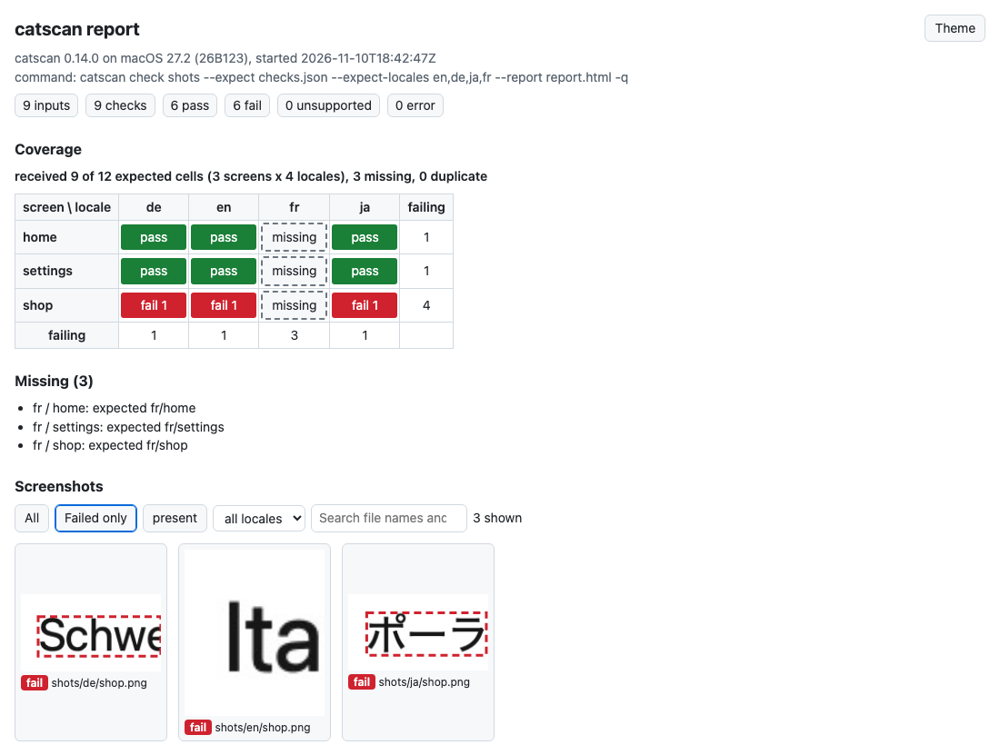

# HTML report

One self-contained HTML file for a person who reviews a run: which locales and screens arrived, which failed, and the failing boxes drawn on the screenshots. It is built from the results file ([results.md](./results.md)), so a single run and a sharded CI run give the same page.



## A single run

```bash
npx @catscan/cli check shots --expect checks.yaml --expect-locales de,fr,ja --report catscan-report.html
```

`--report` works with `check`, `read`, `untranslated`, `video`, `truncated`, `overlap`, `formats`, `fit` and `contrast`. It does not need `--results`, and it never changes the exit code; a report that cannot be written is exit 4 (`report-write-failed`). When it is written, stderr says where:

```
catscan: report: catscan-report.html (3.2 MB, 36 images)
```

## A sharded run

Each shard writes its results file; one job renders them all:

```bash
npx @catscan/cli report shard-*.json --expect-locales-from locales --out catscan-report.html
```

`catscan report` merges the files as `results merge` does, takes the same `--layout` and expectation options, and exits with the code of the merged run: a missing locale fails it (exit 1). The screenshots are read from `--images-root` (default: the working directory), where the paths in the results files are relative to. A screenshot it cannot find is drawn as a grey placeholder with its boxes, and `report-image-missing` names the path it tried (at most 10 lines, then a count). If the core binary cannot make any thumbnail (it cannot start, or it exited), one `report-images-unavailable` warning says so with the hint `catscan doctor`, and the exit code still follows the verdicts.

## What the page shows

- **Coverage matrix**: one row per screen, one column per locale, from `--layout` (default `{locale}/{screen}`). Each cell is `pass`, `fail` with its finding count, `error`, `needs-reader`, `unsupported` or `missing`. Set `--expect-locales` (or `--expect-locales-from`) and `--expect-screens` in CI: without them, a locale whose screenshots never arrived is simply not in the matrix. With them, the line above the matrix counts cells: `received 287 of 300 expected cells (12 screens x 25 locales), 13 missing, 2 duplicate`. A cell outside the expected sets has an `unexpected` badge (a typo in a folder name); a cell with several screenshots under one command has a `duplicate` badge (results of different commands for one screenshot, such as `check` and `untranslated`, are not duplicates). A file merged by catscan 0.23 or older keeps its old `duplicate` badges until its shards are merged again.
- **Devices** <a id="devices"></a>: with results from several devices ([Device axis](results.md#device-axis)), each locale column splits into one sub-column per device, under a two-row header (locale, then device), devices ordered by platform then label; the screen column stays in place while a wide matrix scrolls sideways. Each sub-cell keeps its own verdict and worst severity. Row and column totals count cells, so one screen and locale on two devices counts two, and the coverage line names the factor: `received 118 of 120 expected cells (12 screens x 5 locales x 2 devices), 2 missing, 0 duplicate`. Chips above the matrix (`all`, then each device) filter the matrix, the screenshots and the coverage line together. A device outside `--expect-devices` has the `unexpected` badge. In the image view, the up and down arrows switch to the same screen and locale on the previous or next device. With one device the matrix looks as without the axis, and the header names the device and its platform. When no input matches the layout but the run suggested a `{device}/` layout, the page names that layout.
- **Text sizes** <a id="text-sizes"></a>: with results at several text sizes ([Text-size axis](results.md#text-size-axis)), each device column splits into one sub-column per size, in label order (`default`, `large`, then the exact labels), and the coverage line adds the factor (`x 2 text sizes`). A cell at a size other than `default` that fails while the same device, locale and screen passes at `default` gets the `large text` badge: a defect the default run cannot see. No badge when the `default` cell is missing or does not pass. The `Large text` filter above the screenshots shows exactly the inputs of those cells. In the image view, up and down move through the sizes and devices of one cell, so a large-text shot is one key from its default. With one size the matrix looks as without the axis, and the header names the size.
- **Missing and unmapped**: each expected cell with no screenshot, with the path it was expected at; each input whose path did not match the layout.
- **Screenshots**: thumbnails in rank order (error, needs-reader and unsupported inputs first, then by each input's worst gating item: severity, then certainty; a results file without severities keeps failed first), with filters (failed only, a finding kind, a locale, a severity, a certainty) and a search over file names and recognized text. The image view lists each check and finding sorted, with a `<severity>/<certainty>` badge; a finding below the run's thresholds is marked `note`, and an approved one (`--known`; [known findings](results.md#known-findings)) is marked `known` and listed last. With known findings the filters add Known, the screenshots that have them. A matrix cell keeps its verdict and shows its worst severity ([severity and certainty](cli.md#severity-and-certainty)).
- **Image view** (click a thumbnail or a cell): the boxes, the list of checks and findings (hovering one highlights its box), and the raw JSON. Left and right arrows move between images, `Esc` closes.
- **Changed-only review** (a run or `catscan report` with `--baseline`; [`results.md`](results.md#changed-only-review)): the header shows the summary line (`baseline 4511: 241 of 287 cells text unchanged and passing (84%), ...`), the baseline build and approval date, the skip share with its denominator and what it excludes (missing, unmapped), and that images, layout and colors are not compared. Each matrix cell gets a second mark: a dot for `changed`, a `new` or `ambiguous` badge, none for `unchanged` (dimmed when skippable), and a grey `gone` cell for a screen only in the baseline. A cell's tooltip and its image view say why it needs review (text changed, a check fails, reader changed, ...). The "Needs review only" filter is on by default: the matrix and the screenshots show only the cells to review, plus missing cells (a coverage gap is never hidden). The image view of a `changed` cell lists added (`+`) and removed (`-`) lines; a `minor OCR difference` (punctuation or diacritics only, still skippable) is collapsed. With `--text-record digest` the page has no line diff, because the results file holds no text record lines.
- **Videos**: a timeline per video with marks where each text was first and last seen, and where a failed check came closest, plus frame thumbnails at the failed times (at most 10).

Box colors come with a line style and a label, so the page never relies on color alone:

| Finding | Box |
| --- | --- |
| Present check passed | green, solid |
| Present check failed (closest line) | red, dashed |
| Absent check failed (text found) | red, solid |
| Truncated | orange, solid |
| Truncated, overflow (text drawn past its element) | orange, dashed |
| Overlap | purple, solid, both boxes (stacked text: its one line box) |
| Untranslated, raw key, placeholder, wrong language | blue, solid |
| Cut pseudo string (`pseudo-cut`, label `cut (pseudo)`) | orange, dashed |
| Hardcoded (`--pseudo`) | blue, dashed |
| Format, currency, price (`formats`) | yellow, solid |
| Under a cutout, corner or home indicator (`fit`) | pink, dashed, two boxes: the zone and the hidden letters (or the control) |
| Low contrast (`contrast`, `low-contrast`) | dark orange, solid |
| Text over a busy background (`contrast`, `busy-background`) | dark orange, dashed |
| Wraps, or ends in one word (`fit` `wrapped`, `orphan`) | pink, solid, the element's rows |
| Pseudo locale not loaded (`pseudo-not-applied`, no box) | listed with the label `pseudo not loaded` |

## Images

- `--report-images embed` (default): each screenshot is stored once in the file as a JPEG (quality 0.7) scaled to `--report-max-edge` (default 800 px on the long edge). The binary makes the JPEGs with ImageIO; nothing else is installed.
- `--report-images link`: PNG, JPEG, GIF and WebP screenshots are referenced by a relative path instead, so the file is small but needs the screenshots next to it. HEIC, TIFF and BMP files, paths outside the working directory (`abs:`) and video frames are still embedded, because browsers cannot open them from a link. A report written outside the screenshots' root embeds too.

Over 50 MB, `report-large` suggests `--report-images link` or a smaller `--report-max-edge`.

## Opening a CI artifact

The report is one file with its CSS and script inline and makes no network request: no fonts, CDNs or analytics. Download the artifact (`catscan.html` in [`examples/ci/`](../examples/ci/)), unzip it, and open it in any browser; it works offline and from an email attachment. A `link` report needs the screenshots unpacked beside it.

## Privacy

The report contains your screenshots and their recognized text. Treat it like the screenshots: keep CI artifacts short-lived and share the file only with people who may see them. It is written only when you pass `--report` or run `catscan report`. Paths and the recorded command line get the same rewrite as the results file: a path outside the working directory becomes `abs:<last folder>/...`, so the file names no home folder or user name.

## Safety

Screen text, file names and catalog values can hold markup. The page inserts every such string as text, never as HTML, and a Content Security Policy allows only its own inline script (by hash) and `data:` images (plus local files in `link` mode). Opening a report from an untrusted run cannot run script from its data.
